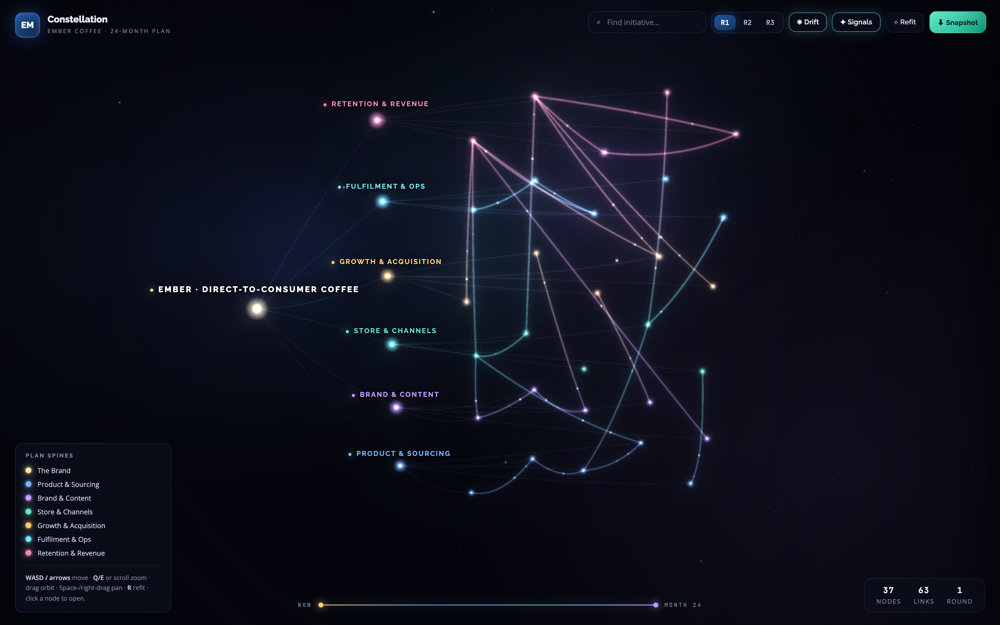
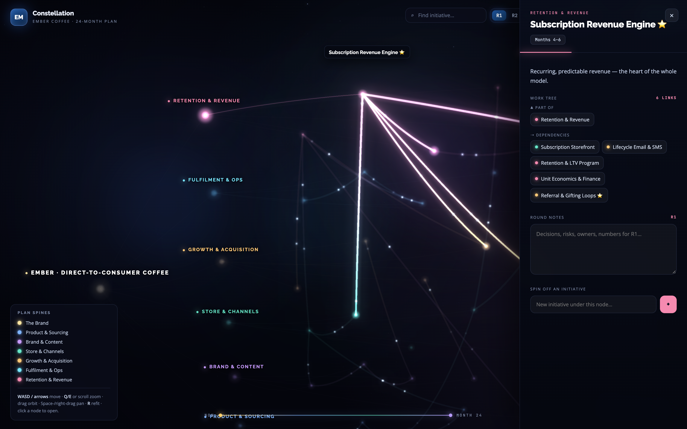
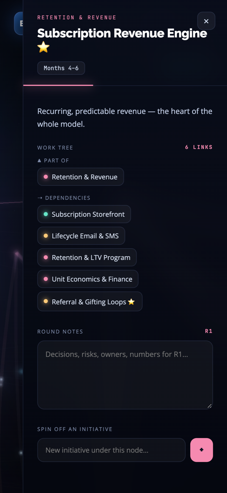

# Constellation

**Turn a business plan into a 3D map you can actually walk through — every initiative a node, every dependency a visible link.**

Constellation is an interactive 3D planning canvas that renders a written business plan as a navigable "neural web." Instead of scrolling a PDF or clicking through slides, you fly a camera through the plan itself: pillars become spines, initiatives become nodes, and the dependencies between them become glowing links you can trace end to end. You can select any node, read its context, annotate it per planning round, and spin off new initiatives that appear in the graph live.

It runs entirely in the browser as a single, portable HTML file — no build step, no server — and deploys as a static page on GitHub Pages.

**▶ Live demo: [abbytes-sudo.github.io/interactive-business-planner-3d](https://abbytes-sudo.github.io/interactive-business-planner-3d/)** · sample plan · AI-assisted build

---

## Screenshots

| Node selected | On a phone |
|---|---|
|  |  |

*The demo loads a fictional D2C specialty-coffee brand, **Ember**, and its 24-month launch plan across six pillars — Product & Sourcing, Brand & Content, Store & Channels, Growth & Acquisition, Fulfilment & Ops, and Retention & Revenue. It's sample data, there to show what the tool does with a real plan.*

---

## Why it exists

Most business plans live in PDFs and slide decks. That format hides the two things that matter most: the **timeline** and the **dependencies**. You can't see that a retention initiative can't start until fulfilment is in place, or that three growth bets all hang off one piece of brand work — not without reading the whole document and holding it in your head.

Constellation makes the plan spatial. Every initiative is a node placed on a Now → Month 24 timeline. Every dependency is a link you can literally follow, with signal particles showing which way the work flows. You can walk the plan, annotate it as your thinking changes across planning rounds, and extend it in place — so the plan becomes a living model instead of a document that goes stale the day it's exported.

Built as a personal product experiment, AI-assisted: I scoped a real problem, made the product and design decisions, directed AI coding agents and tested what shipped.

---

## Features

**The 3D graph**
- One root (the brand) → six pillar "spines" → ~30 initiative "atom" nodes.
- Nodes laid out in lanes, left → right, along a **Now → Month 24** timeline, so position encodes *when*.
- Two link types: thin gradient **hierarchy** lines (what belongs to what) and thick, glowing **dependency** tubes.
- Dependency tubes carry animated **signal particles** that flow source → target, so you can see the direction of the work at a glance.
- UnrealBloom post-processing gives the graph its lit, luminous look — with graceful degradation to a flat render if post-processing isn't available.

**Click to focus — the side panel**
- Click any node and the camera **flies to it**; a detail panel opens with its kind, name, timing, and description.
- A **work tree** shows *Part of / Feeds into / Dependencies* as clickable chips — navigate the plan by relationships, not by hunting.
- **Round notes** — jot per-round thoughts against each node (R1 / R2 / R3), saved locally.
- **Spin off an initiative** — add a brand-new node *and* its dependency straight into the live graph, no reload.

**Working the plan**
- **Planning rounds** R1 / R2 / R3, each with its own set of notes, so you can see how thinking evolved.
- **Search**: type an initiative's name and press Enter to fly straight to it (desktop).
- **Drift** and **Signals** toggles to calm or energise the scene; **Refit** to reframe the whole plan.
- **Snapshot export** — download the current plan as a single HTML file, with all your notes and added nodes baked in (the libraries still load from the CDN). Share the plan, not a screenshot.

**Camera & interaction**
- Custom orbit camera built directly on Three.js: **drag** to rotate, **scroll / Q–E** to zoom, **WASD / arrows** to pan, **Space or right-drag** to pan, **R** to refit.
- **Touch:** drag to orbit, pinch to zoom, two-finger pan, tap a node to select.
- Gentle **auto-drift** when idle; **smooth fly-to** on selection.
- **Hover** highlights a node's neighbourhood and dims everything else; tooltips on atoms.

**Persistence & platform**
- All notes and added nodes persist in **localStorage** across sessions.
- **Responsive** — on mobile the side chrome collapses and the detail panel fills most of the screen.
- **HUD** with the brand mark, a legend of plan spines, a Now → Month 24 flow bar, and live stats (node count / link count / current round).
- Boot error handling so a bad state fails visibly, not silently.

---

## Built with

- **React 18** — the UI shell (HUD, panels, search, toggles).
- **Three.js r147** — the WebGL scene, camera, and rendering, written directly against the raw API (no react-three-fiber, no helpers library).
- **UnrealBloom** post-processing for the glow.
- **Babel-standalone** — the app script is transformed in the browser at load, so there's no build-time compile step.
- **Single file, no build** — one HTML document (~550 lines), no bundler, no framework scaffolding.
- **GitHub Pages** — deploys as a static file. Everything comes from a CDN at runtime, at pinned versions (React 18.3.1, Babel-standalone 8.0.7, Three.js 0.147.0), so a new library release can't break the demo.

---

## How it works

Constellation is deliberately one portable HTML file. The app script is transformed **in the browser** by Babel-standalone at load time, which is what removes the build step entirely — you can open the file locally or drop it on any static host and it just runs.

Under the React shell sits an **imperative Three.js scene**: React owns the chrome (HUD, side panel, search, round switching) and drives state, while the 3D world — geometry, materials, the custom orbit camera, the animation loop, hover picking, and the fly-to transitions — is managed directly against Three.js. The two layers talk through a thin boundary, so interface state and scene state stay in sync without either owning the other. Keeping it to a single file was a design constraint, not a shortcut: it forced clean seams and made the whole thing trivially portable.

---

## Run it

Open `index.html` in any modern browser, or visit the **[live demo](https://abbytes-sudo.github.io/interactive-business-planner-3d/)**. Everything loads from a CDN — there's nothing to install and nothing to build.

---

## About

A personal product experiment, built AI-assisted. I scoped the problem and decided the data model (root → spines → atoms with typed links), the interaction design (fly-to focus, work-tree navigation, per-round annotation) and what shipped. AI coding agents wrote the code under my direction; I tested it on desktop and mobile and deployed it to GitHub Pages.

More work at **[github.com/abBytes-sudo](https://github.com/abBytes-sudo)**
